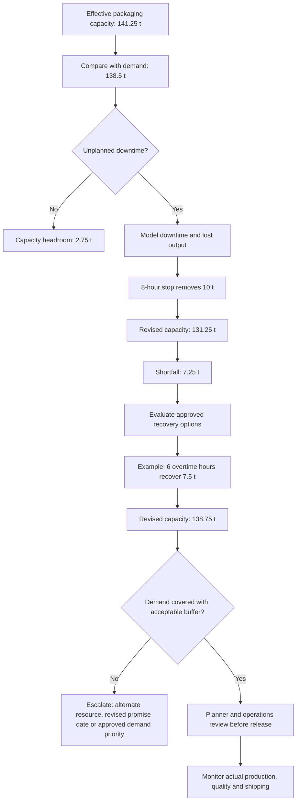

# Bottleneck and Recovery Decision Flow

This decision logic is based on illustrative weekly demand of 138.5 t and effective packaging capacity of 141.25 t before disruption.

## Interpretation

The example overtime recovery covers modeled demand by just 0.25 t; this is a narrow buffer and should not be described as a robust recovery without checking real operating variability. The recovery capacity also does not support a separate 140 t target. Alternative capacity, split production, or revised delivery commitments should be reviewed where overtime is unavailable or the buffer is too small.
