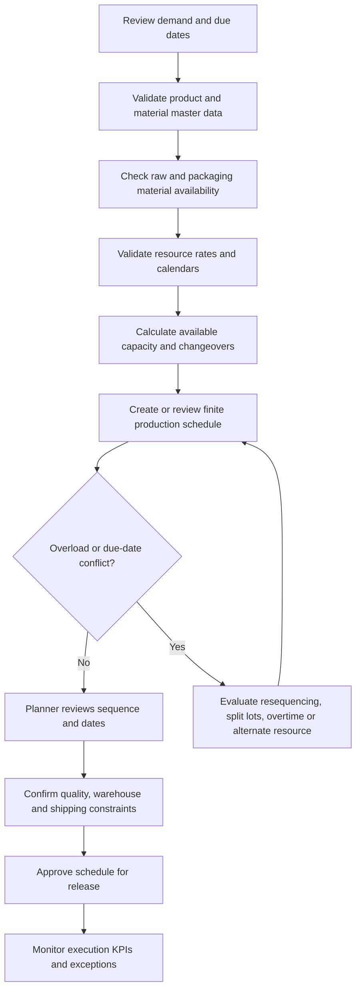

# Production Planning Flow

The flow below summarizes the proposed planner workflow for the illustrative case study.

## Planner checkpoints

- Use verified master data and calendars; capacity output is only as reliable as those inputs.
- Do not assume material availability based on lead time alone—check actual or planned receipts.
- Review the finite schedule with production stakeholders before release.
- Record the reason for each manual change and compare actual results with the planned schedule.
